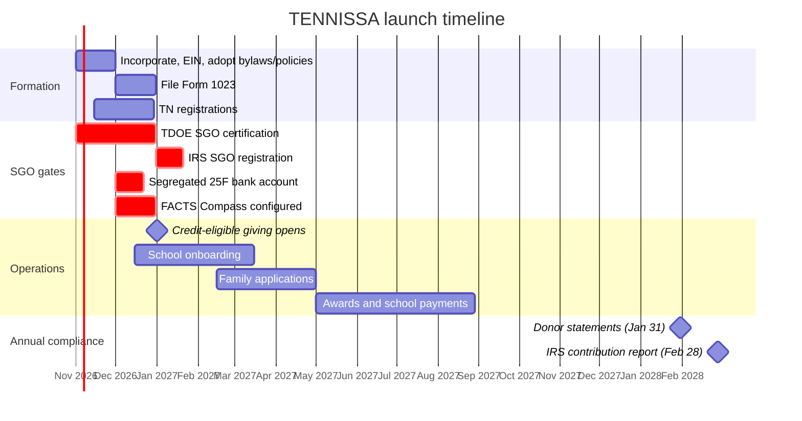

# TENNISSA SGO Startup Checklist

**Tennessee Islamic School Scholarship Alliance, Inc.** · From incorporation to the first scholarship award

 

This checklist covers everything TENNISSA must do to operate as a scholarship granting organization (SGO) under the federal scholarship tax credit (IRC § 25F) in Tennessee. It runs from corporate formation through the first full annual cycle. Tick items off in GitHub as they are done, and link each finished item to its evidence: a filing receipt, a resolution number or a pull request.

> ⚠️ **Verify before relying on it.** Section 25F is new, and IRS forms, portal steps and deadlines are still being issued. Before acting on any item marked 🔎, confirm it against current IRS, Tennessee Department of Education (TDOE), Secretary of State and Department of Revenue guidance. This checklist is a project-management tool, not legal or tax advice. Have it reviewed by Tennessee nonprofit counsel and a CPA.

---

## How to use this checklist

| Symbol | Meaning |
|---|---|
| `- [ ]` / `- [x]` | Open / done (click the box on GitHub) |
| 🔴 | **Gate.** Credit-eligible donations cannot open until this is done. |
| 🔎 | Confirm against current official guidance |
| ⏱️ | Has a legal deadline |

**Owners:** **ED** Jimmy Ardiansyah (Executive Director) · **CD** Nur Sisworahardjo (Compliance Director) · **FC** Andi Hermanto (Financial Controller Director) · **BD** full Board · **CPA** outside accountant · **LC** legal counsel

### Progress overview

| Phase | Focus | Target | Owner |
|---|---|---|---|
| [0](#phase-0--foundations-and-key-decisions) | Foundations and key decisions | Now | BD |
| [1](#phase-1--incorporate-and-organize) | Incorporate and organize | Nov 2026 | ED · LC |
| [2](#phase-2--federal-tax-exemption) | Federal tax exemption (501(c)(3)) | Nov 2026 – 2027 | FC · CPA |
| [3](#phase-3--tennessee-state-registrations) | Tennessee registrations | Nov – Dec 2026 | ED · FC |
| [4](#phase-4--sgo-certification-and-irs-registration) | SGO certification and IRS registration 🔴 | Nov – Dec 2026 | CD |
| [5](#phase-5--banking-and-financial-controls) | Banking and financial controls 🔴 | Dec 2026 | FC |
| [6](#phase-6--platform-data-and-technology) | Platform, data and technology 🔴 | Dec 2026 | ED · CD |
| [7](#phase-7--risk-management-and-insurance) | Insurance and risk | Dec 2026 | FC |
| [8](#phase-8--school-network) | School network | Dec 2026 – Mar 2027 | ED · CD |
| [9](#phase-9--donor-launch) | Donor launch | Jan 1, 2027 | ED |
| [10](#phase-10--first-scholarship-cycle) | First scholarship cycle | Feb – Aug 2027 | ED · CD |
| [11](#phase-11--year-end-and-annual-compliance) | Year-end and annual compliance | Dec 2027 – 2028 | CD · FC |

---

## Phase 0 — Foundations and key decisions

- [x] Choose the organization's name, mission and public identity (TENNISSA)
- [x] Pick the SGO platform: **FACTS Compass** for applications, donations and donor statements
- [x] Build the Phase 1 interest website (tennissa.org)
- [ ] Secure the domain, nonprofit email (Google Workspace or Microsoft 365 nonprofit programs) and a shared document drive owned by the organization, not by individuals — ED
- [ ] Engage **Tennessee nonprofit counsel** and a **CPA** familiar with exempt organizations and § 25F — BD
- [ ] Make the Board decisions in the policy review notes (`tennissa-policies/REVIEW-NOTES.md`) (D1–D9) — BD
  - [ ] D1: allow a transitional window for schools in CISNA candidacy?
  - [ ] D3: coordination ("last-dollar") rule with EFS/ESA
  - [ ] D5: recruit two **independent directors** (requires amending Bylaws §4.2)
- [ ] Confirm that at least **two** Tennessee Islamic schools meet the school requirements (TDOE Category I/II/III plus CISNA), since § 25F requires scholarships at more than one school — ED · CD

## Phase 1 — Incorporate and organize

- [ ] File the **Charter** (articles of incorporation) for a Tennessee nonprofit corporation with the Secretary of State — LC
  - [ ] Include 501(c)(3) purpose and asset-dedication (dissolution) clauses
  - [ ] Declare "no members", consistent with Bylaws Art. III
  - [ ] Appoint a registered agent and registered office
- [ ] Get an **EIN** from the IRS (free, online) — ED
- [ ] Hold the **organizational meeting**, with minutes — BD
  - [x] Draft the Bylaws, including §4.4 for the Founding Directors
  - [ ] Have counsel review §4.4 and the founder-consent clause in §14.1 — LC
  - [ ] Amend §4.2 so the Board can grow to 5 seats — BD
  - [ ] **Adopt the Bylaws** and sign the Certificate of Adoption — BD
  - [ ] Elect officers: President/Chair, Secretary, Treasurer — BD
  - [ ] Appoint the Executive Director and approve a written compensation resolution, using fixed pay and § 4958 comparability data — disinterested directors only
  - [ ] Authorize the bank accounts (§5) and the people allowed to sign — BD
  - [ ] Adopt the fiscal year (calendar year) — BD
- [ ] **Adopt the Policy Manual v5.0** (8 policies) using the adoption resolution — BD
  - [x] Draft and complete the legal review of the policies
  - [ ] Counsel and CPA sign-off
  - [ ] Every director signs the conflict-of-interest statement (COI-001 Appendix A)
- [ ] Set up the **governance records**: minute book, policy repository, bylaws repository, permanent records folder — CD
- [ ] 🔎 Federal beneficial ownership (CTA/BOI) reporting: FinCEN's March 2025 interim rule exempts domestic entities. Confirm it is still not required — LC

## Phase 2 — Federal tax exemption

- [ ] Prepare **IRS Form 1023**, filed electronically on Pay.gov, with the user fee 🔎 — FC · CPA · LC
  - [ ] Include the Charter, Bylaws, conflict-of-interest policy, a narrative of activities, and a 3–4 year budget
  - [ ] Request public charity status under §§ 509(a)(1) / 170(b)(1)(A)(vi) (broad public support)
  - [ ] Describe the scholarship program: criteria, selection, independence and records, following IRS scholarship-program guidance
  - [ ] ⏱️ File within **27 months** of incorporation so that exemption applies back to the date of formation
- [ ] Receive the **determination letter**. Store it permanently and post it on the website — ED
- [ ] Until the letter arrives, describe the 501(c)(3) status as "**pending**" on all materials — ED

## Phase 3 — Tennessee state registrations

- [ ] 🔎 **Charitable solicitation** (Secretary of State, Division of Charitable Solicitations): register **before** soliciting, or file the small-charity exemption if gross contributions are under the threshold (currently about $50,000) and no paid solicitor is used. Renew every year — ED
- [ ] 🔎 **Department of Revenue**:
  - [ ] Apply for the franchise and excise tax exemption (nonprofit exemption application)
  - [ ] Apply for the sales and use tax exemption certificate, if TENNISSA will buy taxable goods — FC
- [ ] ⏱️ **Secretary of State annual report**, due each year by the deadline set for the corporation's fiscal year-end — ED
- [ ] If TENNISSA hires employees: register with the TN Department of Labor and Workforce Development for unemployment insurance; set up payroll and federal withholding (Forms 941/W-2); check the TN workers' compensation threshold — FC
- [ ] Before soliciting **outside Tennessee** (for example, by mail or events in other states), check that state's registration rules — CD

## Phase 4 — SGO certification and IRS registration

> 🔴 **Gate.** Gifts qualify for the § 25F credit only when TENNISSA is on Tennessee's list of SGOs **and** registered with the IRS. Gifts must also be made on or after **January 1, 2027**.

- [ ] Confirm Tennessee's **advance election** into the § 25F program is in effect (Tennessee filed Form 15714) 🔎 — CD
- [ ] Submit the **TDOE SGO interest form / application** (opened October 7, 2026) 🔎 — CD
  - [ ] Gather the Charter, Bylaws, EIN, 501(c)(3) letter or pending application, policies, list of directors and officers, and participating-school plan
  - [ ] Respond to TDOE follow-up questions and keep copies of every exchange
- [ ] Receive **TDOE certification** and confirm TENNISSA appears on the state list provided to Treasury 🔴 — CD
- [ ] Complete **IRS SGO registration** through the IRS SGO portal 🔴 🔎 — CD
  - [ ] Set up portal access for at least two authorized users, the Compliance Director and the Financial Controller Director
- [ ] Record both approvals in the minutes. Store the evidence permanently (REC-001) — CD
- [ ] Update the website status banner: "Certified SGO. Credit-eligible giving is open." — ED

## Phase 5 — Banking and financial controls

- [ ] Open the **operating account** in TENNISSA's legal name and EIN — FC
- [ ] Open a **separate § 25F scholarship account**. Only individuals' cash gifts, interest earned and school refunds may go in 🔴 — FC
- [ ] Require **dual authorization** for every payment out of the § 25F account, and for any other payment over $1,000 — FC
- [ ] Choose the **accounting system** (for example QuickBooks Online for Nonprofits) with separate funds and classes for 25F and operating — FC · CPA
- [ ] Build the **90% spending tracker**: group gifts by the year they were received, spend oldest first, and meet the two-year deadline (FIN-001 §6.3) — FC
- [ ] Adopt the **first-year budget** with 25F and operating shown separately — BD
- [ ] Set up the monthly bank reconciliation and its second-person review — FC
- [ ] Engage the **independent auditor**, and confirm the § 25F audit scope and any small-SGO option 🔎 — BD
- [ ] Set up the **payment processing** fee structure. Card fees on 25F gifts are an administrative cost and must fit within the 10% that is not spent on scholarships — FC

## Phase 6 — Platform, data and technology

- [ ] Sign the **FACTS Compass** agreement, with a data protection addendum (PRIV-001 §6) — ED · LC
- [ ] Configure the platform 🔴 — ED · CD
  - [ ] Donation forms collect each individual donor's name, address and the details needed for the IRS donor statement
  - [ ] Mark only cash gifts from individuals as § 25F; send corporate and noncash gifts to operating funds
  - [ ] Generate the **donor statement / written acknowledgment** with the IRS donor number, in IRS format 🔎
  - [ ] Build the family application with **300% of area median income** testing (HUD figures), categorical eligibility (SNAP, TANF, WIC, housing assistance, SSI), consents, the EFS/ESA/IEA disclosure, and no Social Security numbers
  - [ ] Add the disqualified-person screening question and a match against the annual COI disclosures
  - [ ] Set up the school portal for enrollment confirmation and tuition invoices
  - [ ] Give roles least-privilege access and turn on MFA for every user
- [ ] Turn on MFA for email, banking, the platform and cloud drives — ED
- [ ] Publish the **privacy notice** on the website and link it from every form — CD
- [ ] Hold privacy and security training for everyone with access — CD
- [ ] Website — ED
  - [ ] Connect the interest form to Formspree (or move it to FACTS) and test it
  - [ ] Replace the watermarked stock photos with licensed images
  - [ ] Add board photos and the intro video
  - [ ] Make the school-eligibility wording on the About page match the Board's D1 decision
  - [ ] Add the credit qualifier wherever "zero cost" or "isn't just a donation" appears (DON-001 §10)
  - [ ] Set `donationsOpen: true` and the Give link in `config.js` **only after** the Phase 4 gates are met

## Phase 7 — Risk management and insurance

- [ ] **Directors and officers (D&O)** liability insurance — FC
- [ ] **Crime / fidelity** coverage at least equal to the highest expected 25F balance — FC
- [ ] **General liability** insurance for events — FC
- [ ] **Cyber liability** insurance, because TENNISSA holds income and donor data — FC
- [ ] Workers' compensation, if TENNISSA has employees — FC
- [ ] Name the **independent whistleblower contact** (outside counsel or CPA) and post it on the website (WB-001 §4) — BD

## Phase 8 — School network

- [ ] Publish the school eligibility rules and the application (SCH-001 §3) — ED
- [ ] Recruit and onboard schools — ED
  - [ ] Verify TDOE **Category I/II/III** on the official TDOE list and save a screenshot or PDF with the date
  - [ ] Verify **CISNA** accreditation, or candidacy if D1 is adopted
  - [ ] Collect the nondiscrimination certification (race, color, national origin)
  - [ ] Collect tuition and fee schedules for 2027–28
  - [ ] Sign the **participation agreement**: payments, refunds, enrollment checks, FERPA-limited data sharing, notice of status changes
  - [ ] Collect remittance details (ACH) and a W-9
- [ ] Screen for conflicts: directors connected to a school step out of that school's approval (COI-001 §9) — CD
- [ ] Confirm **at least two** schools are approved before the application window opens — CD
- [ ] Optional: build the school logo strip on the website once schools give permission to use their logos — ED

## Phase 9 — Donor launch

- [ ] Draft donor materials (website, flyer, postcard, video, newsletter) and get them compliance-approved (SGO-001 §6) — ED · CD
  - [ ] Every piece states that the credit is up to $1,700 per person, nonrefundable, carries forward 5 years, is for cash gifts from individuals only, cannot be earmarked for a student, and that TENNISSA does not give tax advice
- [ ] Prepare the gift acknowledgment templates: § 25F donor statement, § 170(f)(8) letter for gifts of $250 or more, and § 6115 quid-pro-quo disclosure for events — CD
- [ ] Set up the donor CRM and the opt-in for the public donor list (anonymity is offered publicly only) — ED
- [ ] Brief directors on the **substantial-contributor rule**: large donors' families become ineligible for scholarships — CD
- [ ] Tell everyone on the interest list that giving is open (only after the Phase 4 gates) — ED
- [ ] ⏱️ **January 1, 2027**: credit-eligible giving opens
- [ ] Prepare a year-end campaign plan. Gifts must be made **by December 31** to count for that tax year — ED

## Phase 10 — First scholarship cycle

- [ ] Publish the 2027–28 award criteria, priority order, award ranges and deadlines **before** applications open (SCH-001 §5) — ED
- [ ] Appoint the **Scholarship Committee** (at least 2 people), with COI statements signed. Committee members' own families are ineligible — BD
- [ ] Open family applications and give help in English and other community languages as needed — ED
- [ ] Verify each application: income, Tennessee residency, eligibility to attend public school, enrollment, and EFS/ESA/IEA coordination — ED
- [ ] Run the **disqualified-person screen** on every applicant — CD
- [ ] Rank applicants: renewals, then siblings, then need-based ranking. Confirm at least the § 25F minimum number of students across more than one school — CD
- [ ] Committee approves awards. Record the approvers and the reason for each — Committee
- [ ] Send award letters with terms and appeal rights (15 business days to appeal) — ED
- [ ] Pay schools **directly** after they confirm enrollment, with dual authorization from the 25F account — FC
- [ ] Handle withdrawals and refunds under the participation agreement — FC
- [ ] Give the Board quarterly reports on applications, awards, the 90% tracker and compliance — ED · FC

## Phase 11 — Year-end and annual compliance

Recurring every year. Copy this section into a new GitHub issue each January.

| ⏱️ When | Task | Owner |
|---|---|---|
| Dec 31 | Last day for gifts to count in the tax year. Close the books for 25F gift records | FC |
| Jan | Annual COI and disqualified-person statements. Update the substantial-contributor list | BD |
| **Jan 31** | Send each donor the § 25F **written acknowledgment** with their IRS donor number (for Form 8525) 🔎 | CD |
| **Feb 28** | File the annual **contribution report** in the IRS SGO portal 🔎 | CD |
| Quarterly | Update the 90% spending tracker. Reconcile the 25F account. Report to the Board | FC |
| Spring | **Independent audit** (financial and § 25F program) 🔎 | FC · CPA |
| May 15 (or extended date) | **Form 990** with the § 25F schedule/information. Board reviews it before filing 🔎 | FC · CPA |
| Jun 30 (calendar-year filers) | Renew the **TN charitable solicitation** registration or exemption 🔎 | ED |
| Annual report deadline | File the TN Secretary of State annual report | ED |
| Before each award cycle | Re-verify schools. Publish criteria. Update HUD income limits in the application | CD |
| Q4 | Board reviews **all policies and the Bylaws**. Update the GitHub repositories | BD |
| Ongoing | Keep the 990, 1023 and determination letter available for public inspection | ED |

---

## Key documents

| Document | Status | Location |
|---|---|---|
| Charter (articles of incorporation) | ☐ Filed | Secretary of State |
| Bylaws | ✅ Drafted · ☐ Adopted | `tennissa-bylaws` repo |
| Policy Manual v5.0 (8 policies) | ✅ Drafted · ☐ Adopted | `tennissa-policies` repo |
| Form 1023 / determination letter | ☐ | Permanent records |
| TDOE SGO certification | ☐ | Permanent records |
| IRS SGO registration | ☐ | Permanent records |
| TN charitable solicitation | ☐ | Secretary of State |
| FACTS Compass agreement and DPA | ☐ | Contracts folder |
| Insurance policies | ☐ | Permanent records |
| School participation agreements | ☐ | Platform and contracts folder |

## Official resources

- TDOE Non-Public Schools: <https://www.tn.gov/education/families/school-options/non-public-schools.html>
- CISNA Accreditation: <https://cisnausa.org/accreditation/>
- IRS Form 1023: <https://www.irs.gov/forms-pubs/about-form-1023>
- IRS Form 13909 (complaints about exempt organizations): <https://www.irs.gov/forms-pubs/about-form-13909>
- Federal law and guidance: IRC § 25F; IRS Notice 2025-70; Treasury regulations (T.D. 10057, REG-117199-25). Check irs.gov for the current versions, Form 8525 and SGO portal instructions.
- Tennessee Secretary of State (charters, annual reports, charitable solicitations) and Department of Revenue (nonprofit exemptions): sos.tn.gov · tn.gov/revenue

---

*Prepared October 2026 as a planning tool. Not legal or tax advice. Confirm each 🔎 item with counsel, a CPA or the responsible agency.*
